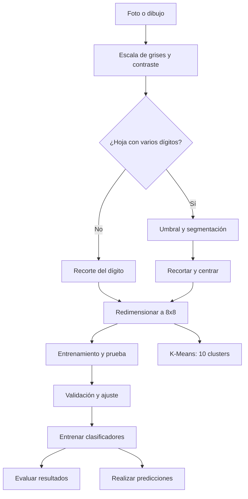

# TecnoForms | Clasificación de dígitos manuscritos

**TecnoForms** es un prototipo académico desarrollado en Python y Streamlit. Su función principal es reconocer dígitos escritos a mano y comparar siete clasificadores supervisados, además de incluir un ejemplo de agrupamiento no supervisado.

## Estructura del proyecto

```text
TecnoForms_Digitos/
├── app/
│   ├── app.py
│   ├── configuracion.py
│   ├── modelado.py
│   ├── procesamiento.py
│   ├── retroalimentacion.py
│   └── styles.css
├── extras/
│   ├── intro/
│   └── musica/
├── correcciones_modelos.csv
├── evidencias/
├── informe/
├── requirements.txt
└── README.md
```

## Requisitos

- Python 3.10 o superior.
- Windows, Linux o macOS.
- Conexión a internet para instalar las dependencias.

## Instalación y ejecución

### 1. Descargar el proyecto

Descarga el repositorio desde GitHub o clónalo con:

```bash
git clone URL_DE_TU_REPOSITORIO
```

Después, entra a la carpeta del proyecto:

```bash
cd TecnoForms_Digitos
```

### 2. Crear el entorno virtual

```bash
py -m venv .venv
```

### 3. Instalar las dependencias

En Windows:

```bash
.venv\Scripts\python.exe -m pip install -r requirements.txt
```

### 4. Ejecutar la aplicación

```bash
.venv\Scripts\python.exe -m streamlit run app/app.py
```

La aplicación se abrirá en el navegador:

http://localhost:8503

Para detenerla, presiona `Ctrl + C` en la terminal.

## Funciones principales

### 1. Reconocimiento de un dígito

Permite dibujar un número en un lienzo o cargar una imagen JPG o PNG. El sistema procesa la imagen y compara las predicciones de siete clasificadores:

- KNN.
- SVM.
- Regresión logística.
- Random Forest.
- Árbol de decisión.
- Extra Trees.
- MLP (red neuronal multicapa).

### 2. Reconocimiento de una hoja

Permite cargar una fotografía o dibujar varios números para intentar detectarlos y reconocerlos.

Incluye opciones para seleccionar el tipo de hoja y revisar los resultados. Esta función utiliza segmentación experimental, por lo que puede verse afectada por sombras, líneas o números unidos.

### 3. Corrección y aprendizaje

Permite corregir las predicciones indicando cuál era el número correcto.

Los ejemplos corregidos se guardan en `correcciones_modelos.csv` y pueden incorporarse al entrenamiento de los modelos.

### 4. Comparación de modelos

Compara los siete clasificadores mediante validación cruzada estratificada de 3 pliegues y búsqueda aleatoria de hiperparámetros.

Muestra:

- Exactitud promedio de validación.
- Desviación estándar.
- Resultados en el conjunto de prueba.
- Mejores parámetros encontrados.
- Arquitectura seleccionada para el MLP.

También incluye un ejemplo de K-Means con 10 clusters.

### 5. Evaluación y gráficos

Permite consultar diferentes métricas para analizar el rendimiento de los clasificadores:

- Matriz de confusión.
- Precisión (Precision).
- Sensibilidad (Recall).
- F1-score.
- Promedios macro.
- Historial de predicciones descargable en CSV.

## Preprocesamiento de imágenes

Antes de realizar una predicción, las imágenes pasan por diferentes etapas:

1. Conversión a escala de grises.
2. Ajuste del contraste.
3. Separación de la tinta y el fondo.
4. Recorte y centrado del dígito.
5. Redimensionamiento a 8 × 8 píxeles.
6. Normalización de intensidades al rango de 0 a 16.

Para las hojas con varios números se realiza una segmentación previa, buscando identificar cada dígito y ordenarlo por filas.

## Flujo de funcionamiento



## Arquitectura de la red neuronal MLP

El modelo MLP utiliza:

- Función de activación ReLU.
- Optimizador Adam.
- Una o dos capas ocultas.
- Diferentes cantidades de nodos para comparar arquitecturas.
- Una capa de salida de 10 clases.

La búsqueda de parámetros permite seleccionar la arquitectura con mejor resultado durante la validación cruzada.

## Otros modelos utilizados

La regresión logística se utiliza como clasificador supervisado para identificar los dígitos.

Por otro lado, K-Means se presenta como un método de agrupamiento no supervisado. Se utilizan 10 clusters, junto con la puntuación de silueta y la distribución de las etiquetas reales.

Los clusters no representan directamente los números del 0 al 9, ya que el algoritmo no utiliza las etiquetas durante el agrupamiento.


## Datos utilizados y metodología

El entrenamiento inicial utiliza el conjunto de datos `load_digits` de Scikit-learn, compuesto por imágenes de dígitos de 8 × 8 píxeles.

Para evaluar los modelos se utiliza una división estratificada:

- 80 % para entrenamiento.
- 20 % para prueba.

La búsqueda de hiperparámetros compara cuatro combinaciones aleatorias mediante validación cruzada estratificada de 3 pliegues.

Después se entrena cada modelo con los mejores parámetros y se evalúa en el conjunto de prueba reservado.

Las transformaciones de aumento de datos se aplican después de seleccionar los parámetros. Las correcciones guardadas también pueden incorporarse al entrenamiento final.

Se utiliza una semilla fija para facilitar la reproducción de los resultados.

## Limitaciones del proyecto

TecnoForms es un prototipo académico y no un sistema OCR empresarial.

El reconocimiento de hojas todavía es experimental. Puede presentar dificultades cuando:

- Los números están unidos.
- Hay líneas de cuadrícula que interfieren.
- Las imágenes tienen sombras.
- Existe poca iluminación.
- Los dígitos aparecen desenfocados.

Los resultados dependen de la calidad de las imágenes y de las características de los números escritos.